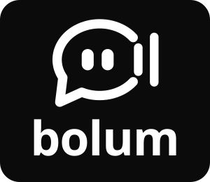

# Bolum

<p align="center"></p>

Push-to-talk dictation for macOS and Linux desktops. Press a shortcut (or run `bolum toggle`
from a compositor keybinding), speak, and the transcript is typed into whatever window has
focus.
Everything runs locally: Whisper through whisper.cpp, or NVIDIA Parakeet/Canary through
ONNX Runtime.

Built in the spirit of [Handy](https://github.com/cjpais/Handy): a Tauri shell, a small
Rust core, and a thin web UI, with the same download-and-verify model strategy.

## Features

- **Local engines** — Whisper (ggml, via whisper.cpp) and NVIDIA Parakeet TDT / Canary
  (ONNX, int8) with SHA-256 verified downloads.
- **Two ways to trigger** — an in-app global shortcut where the desktop allows it, plus a
  `bolum toggle|start|stop|cancel|status|quit` control socket for compositor keybindings.
- **Text delivery that adapts** — on macOS, native key events (CGEvent) or a clipboard
  paste; on Linux, types with `wtype`, `kwtype`, `dotool`, `ydotool` or `xdotool`, or
  pastes through the clipboard.
- **Apple Silicon acceleration** — Whisper runs on the GPU through Metal on macOS.
- **Optional LLM cleanup** — send the transcript through any OpenAI-compatible endpoint
  (Ollama, llama.cpp, LM Studio, OpenRouter, …) before it is inserted.
- **History** — every dictation is kept in a JSON-lines file with copy and delete from
  the app.
- **Tray + overlay feedback** — the tray icon and a small overlay show listening and
  transcribing states.

## Install

Download the latest installer from
[Releases](https://github.com/shivraj598/Bolum/releases/latest):

| Platform | File |
| --- | --- |
| macOS 13.4+ (Apple Silicon) | `Bolum_<version>_aarch64.dmg` |
| Linux x86_64, any distribution | `Bolum_<version>_amd64.AppImage` |
| Debian / Ubuntu | `Bolum_<version>_amd64.deb` |

**macOS:** open the `.dmg` and drag Bolum to Applications. The app is not signed with an
Apple Developer ID yet, so the first launch is blocked. Open **System Settings → Privacy &
Security** and click **Open Anyway**, or run
`xattr -dr com.apple.quarantine /Applications/Bolum.app`.

**Linux:** `chmod +x Bolum_*.AppImage && ./Bolum_*.AppImage`, or
`sudo apt install ./Bolum_*_amd64.deb`.

To build from source instead, see [Build and run](#build-and-run).

## Requirements

### macOS

- macOS 13.4 or later (Apple Silicon, or Intel when building from source)
- Rust (stable), Node.js 20+ and `cmake` (`brew install rust node cmake`)
- Xcode Command Line Tools (`xcode-select --install`)

On first launch macOS asks for **Microphone** and **Accessibility** access (System
Settings → Privacy & Security → Accessibility); the latter lets Bolum insert text into
other apps. Bolum lives in the menu bar and has no Dock icon.

### Linux

- Wayland or X11 session
- Rust (stable) and Node.js 20+
- `cmake` (whisper.cpp build), plus GTK/WebKitGTK development packages for Tauri
- One typing tool on `PATH`: `wtype` (Wayland), `xdotool`, `ydotool`, `dotool` or `kwtype`
- One clipboard tool: `wl-copy`, `xclip` or `xsel`

On Arch:

```sh
sudo pacman -S base-devel cmake webkit2gtk-4.1 gtk3 libappindicator-gtk3 librsvg wtype wl-clipboard
```

## Build and run

```sh
npm ci --include=dev                  # install from the lockfile, including the Tauri CLI
NODE_ENV=development npm run tauri dev
npm run tauri build                   # release bundles in src-tauri/target/release/bundle
                                      #   macOS: Bolum.app + .dmg   Linux: AppImage + .deb
```

`tauri dev` starts Vite on `http://localhost:1420` and launches the app. The web UI reloads
on save, and Rust changes rebuild and relaunch the app. The first run compiles whisper.cpp
and ONNX Runtime, so expect it to take a few minutes. Add `RUST_LOG=debug RUST_BACKTRACE=1`
for verbose logs. `--include=dev` and `NODE_ENV=development` are needed only if your shell
exports `NODE_ENV=production`, which makes npm skip dev dependencies.

Bolum has no Dock icon. Dev builds open the main window on launch. Release builds stay
hidden in the menu bar unless it is the first run or "start hidden" is off; to open the
window, click the Bolum icon in the menu bar and choose **Settings…**.

On macOS in dev mode, Microphone and Accessibility access are granted to the app that runs
the command (Terminal, VS Code, …), not to Bolum.

## Testing

```sh
npm run check        # everything CI runs on each push: types, web tests, build, clippy, Rust tests
npm test             # web UI unit tests (Vitest)
npm run test:rust    # Rust unit tests: catalog, downloads, settings, audio, ONNX decoding, LLM client
npm run test:smoke   # end to end: download Whisper Tiny, verify its SHA-256, transcribe a fixture
```

The smoke test needs the network and a 44 MB download, so `test:rust` skips it. It keeps
its files under `src-tauri/target/tmp/smoke` (or `BOLUM_SMOKE_DIR`) and never touches your
real models or settings.

[GitHub Actions](.github/workflows/ci.yml) runs the web and Rust suites on macOS and Linux
for every push to `main`, every `v*` tag and every pull request. After pushes and tags it
also runs the smoke test against the live model host.

## Usage

Start Bolum (it stays in the tray; the settings window opens on first run):

```sh
bolum            # the GUI/tray process
bolum toggle     # ask the running instance to start/stop dictation
bolum status     # idle | listening | working
```

On macOS the default shortcut is **⌃⌥Space** (Control-Option-Space); change it in the
Dictation tab. To use the CLI, link the binary onto your `PATH`:

```sh
ln -s /Applications/Bolum.app/Contents/MacOS/bolum /usr/local/bin/bolum
```

Hyprland keybinding:

```ini
exec-once = bolum
bind = SUPER, D, exec, bolum toggle
```

Open the **Models** tab, download a model, and press **use**. Then dictate with the
**Dictate** button, the configured shortcut, or `bolum toggle`.

## Models

Recommended models come first in the Models tab; the rest are listed smallest first.

| Model | Engine | Size | Languages | |
| --- | --- | --- | --- | --- |
| Whisper Base (English) | whisper.cpp | ~60 MB | English | recommended, default |
| NVIDIA Parakeet TDT 0.6B v2 | ONNX int8 | ~661 MB | English | recommended |
| NVIDIA Parakeet TDT 0.6B v3 | ONNX int8 | ~670 MB | 25 European languages | recommended |
| Whisper Tiny (English) | whisper.cpp | ~44 MB | English | fastest |
| Whisper Base (multilingual) | whisper.cpp | ~60 MB | 99 languages | |
| NVIDIA Canary 180M Flash | ONNX int8 | ~213 MB | en, de, es, fr (+ translation) | |
| Whisper Small (English) | whisper.cpp | ~190 MB | English | |
| Whisper Small (multilingual) | whisper.cpp | ~190 MB | 99 languages | |
| Whisper Large v3 Turbo | whisper.cpp | ~574 MB | 99 languages | most accurate Whisper |

The accuracy and speed bars on each card are relative guides, not benchmark results.

Weights are fetched from Hugging Face and verified against the SHA-256 recorded in
[`src-tauri/src/models.rs`](src-tauri/src/models.rs) before use. Parakeet and Canary use
the ONNX conversions published by [istupakov](https://huggingface.co/istupakov) in the
[`onnx-asr`](https://github.com/istupakov/onnx-asr) project, built on NVIDIA's
[Parakeet v2](https://huggingface.co/nvidia/parakeet-tdt-0.6b-v2),
[Parakeet v3](https://huggingface.co/nvidia/parakeet-tdt-0.6b-v3) and
[Canary](https://huggingface.co/nvidia/canary-180m-flash) checkpoints (CC-BY-4.0).

## Branding

Logos and icons live in [`branding/`](branding/). Replace a file there and run
`npm run icons` to regenerate the app icon set and the menu-bar icons. The
[branding guide](branding/README.md) lists which file goes where.

## How it works

```
shortcut / `bolum toggle`
        │
        ▼
  cpal capture ──► 16 kHz mono ──► engine ──► (LLM cleanup) ──► typing tool
   (audio.rs)                    (engines/)    (postprocess.rs)   (inject.rs)
```

- `src-tauri/src/settings.rs` — JSON settings store
- `src-tauri/src/audio.rs` — microphone capture, resampling, WAV writing
- `src-tauri/src/models.rs` — catalog, verified downloads, progress events
- `src-tauri/src/engines/` — Whisper (whisper-rs) and NeMo ONNX (ort) transcription
- `src-tauri/src/pipeline.rs` — the dictation state machine
- `src-tauri/src/ipc.rs` — the control socket
- `src/` — the settings window and overlay (vanilla TypeScript + Vite)
- `branding/` — logo, app-icon and menu-bar icon sources

## Credits

- [whisper.cpp](https://github.com/ggml-org/whisper.cpp) and
  [whisper-rs](https://github.com/tazz4843/whisper-rs) for local Whisper inference.
- [onnx-asr](https://github.com/istupakov/onnx-asr) for the NVIDIA ONNX export contracts.
- NVIDIA for the Parakeet and Canary model checkpoints.

## License

MIT — see [LICENSE](LICENSE).
